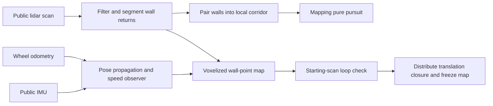
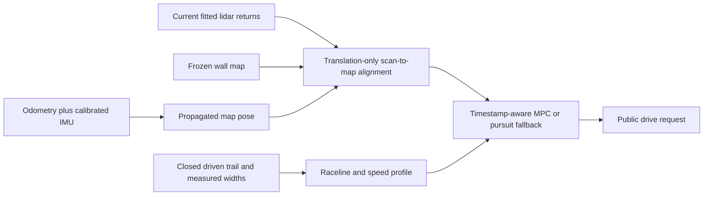

# Configuration and the current mapping/localization stack

This describes the implemented wall racer, including the 2026-10-31 parameter
audit. The member guide release 2, physical pages 6, 7 and 9, supplies the
base/car-overlay, topic and mode-cap contract. Its setup and car-operation
commands were treated as reference, not executed.

## Where settings come from

1. `config/driver.yaml`: all supported startup tuning, with units/comments.
   Its pre-existing values are preserved. Previously hidden vehicle/MPC defaults
   are now explicit using the same tested simulator values.
2. `config/driver.car.yaml`: loaded **only** when `FEB_CAR=1`, after the base.
   It is intentionally empty because no measured car values were supplied.
   Add only measured differences under `wall_racer: ros__parameters:`.
3. `FEB_WALL_RACER_PARAMS` (fallback `FEB_RACER_PARAMS`): an optional explicit
   override file, loaded last.
4. The selected mode's `max_speed` in the package-root `driver.yaml` card is an
   independent upper bound on mapping, racing and published wheel-speed requests.
   Inspection currently uses 0.8 m/s; trackdrive uses 5.0 m/s.

Example car-file structure, without assuming different calibration:

```yaml
wall_racer:
  ros__parameters: {}
```

The shared immutable `VehicleModel` supplies wheelbase, centre offset, steering
limits/rate, delay, wheel conversion, drag and tyre coefficients to the speed
observer, delay predictor, controller and MPC. Lidar offset and vehicle width
are read from the same startup configuration by mapping and path-clearance
geometry. Mapping and pure-pursuit fallback no longer disagree with the MPC's
hard-coded simulator wheelbase or steering limit. Session reset retains the
selected model rather than rebuilding the simulator default.

`race_speed_scale` now actually scales the planned speeds; its supported range
is (0, 1]. `curv_window` controls the peak envelope distance. `track_width` bounds
the scan/map association gate to a quarter of nominal width, also limited by
`map_match_gate`. Existing default behavior is retained for these defaults.
The legacy cone-only `margin`, `curvature_reg` and `corner_scale` are not accepted
as wall tuning; use the documented wall parameters rather than silent no-ops.

Custom tuning is startup-only: edit YAML and restart the driver. Runtime parameter
edits are rejected instead of being accepted while cached control values stay
unchanged. Unknown keys, wrong/mixed node selectors, invalid physical values,
unsafe dimensions and empty sampling domains fail at startup. Adding a new
algorithm knob requires declaring it and wiring its consumer; YAML alone does
not implement new behavior.

ROS parameter reads show the effective values distributed by the modular launcher.
Startup logs show the effective physical model and mode caps. Planning acceleration and
steering slew cannot exceed the configured physical model. `mode_speed_limit`
and `use_sim_time` are launcher-owned, not YAML tuning: the card and `FEB_CAR`
set them consistently for mission and racer.

The stock supervisor still provides its independent output gate and limits.
VESC ERPM/servo conversions, device ports and hardware mounting transforms belong
to the stock car bringup; this change does not modify them. Public `/drive` stays
metres/second and radians. The current stack still requires fresh public `/odom`,
`/scan` and IMU angular-rate data; absolute IMU orientation is used when valid.
No new hardware assumptions, IMU substitutes or unmeasured car model were added.
Wheel radius is not a live-driver YAML knob: encoder-to-distance conversion has
already happened upstream in public `/odom`. The offline Plant retains its
encoder-radius calibration separately.

## Mapping lap



The wall package is a custom lightweight 2D scan-to-map system. It filters lidar
ranges, splits contiguous returns into line segments, and pairs walls along
candidate corridor axes. The local centre samples guide cautious mapping driving.
The nominal mapping target is 1.8 m/s in the base profile; lower mode limits win.

Position starts from public wheel-odometry increments, rotated consistently with
the calibrated IMU heading. A configured tyre/slip observer estimates body speed
from encoder-derived speed for control and travelled-distance accounting.
Absolute IMU orientation is calibrated into the initial odometry/map frame;
invalid/stale orientation falls back continuously to odometry with the last
heading correction. Fresh gyro data remains required.

`slam.py:WallMap` stores sampled wall returns in a bounded 2D voxel map:
0.20 m voxels and at most 8,000 points by default. Mapping keyframes are spaced
by about 0.4 m travelled. Additional repeated left/right voxel votes help select
consistent wall labels. This is a point map, not a probabilistic occupancy grid.

Mapping now uses robust point-to-line registration of X/Y/yaw against the
existing map before inserting each keyframe. Local PCA neighborhoods supply
wall normals; Huber weights reduce outliers. Eigenanalysis of the scaled normal
equations removes poorly constrained directions, preserving predicted movement
along parallel walls. At least 12 correspondences and 35% overlap are required.
No more than eight iterations are performed. The four startup settings are
`scan_match_min_eigen_ratio` (0.03), `scan_match_max_translation` (0.15 m),
`scan_match_max_yaw` (0.06 rad), and `scan_match_max_residual` (0.08 m median
point-to-line error). Excessive corrections are rejected, not clipped into a
different solution. This is a custom planar matcher, not the KISS-ICP package.

Accepted yaw changes persist as an offset to the calibrated IMU/odometry heading
and rotate future odometry increments consistently. Run reset clears that offset.
The racing matcher remains the existing translation-only nearest-neighbor method
(eight matches, median residual below 0.40 m, applied shift at most 0.15 m),
using the heading offset established during mapping.

Loop closure requires enough distance travelled (20 m), proximity to the start,
similar heading and substantial overlap with the initial wall scan. A valid
translation discrepancy is distributed over the mapping path and wall samples,
then the point map is frozen. There is no full pose-graph optimization.

## Racing localization and planning



During racing, the map remains fixed. Odometry/IMU propagate pose and each scan
is matched against nearby frozen wall points to correct translation. A failed
match for 1.5 s reduces the speed cap to `blind_speed` (0.8 m/s by default);
8 s without accepted localization latches a stop. Sensor/state/mission stops
continue to apply independently.

The closed driven trail and measured scalar corridor widths generate a sampled
track, constrained raceline and peak-curvature speed profile. The MPC tracks the
configured car centre, predicts through queued commands and state age, and uses
configured bicycle geometry and dynamics. The normal horizon is 20 x 0.1 s.

This is not an EKF, particle filter or globally optimized landmark graph. Pose
uncertainty is not represented as a covariance distribution. Translation along
long parallel walls can remain ambiguous despite good match residuals. Generated
track boundaries are inferred around the driven trail; they are not a fitted
continuous wall surface. Those limitations, and a separate racing swept-path
clearance guard, remain outside this parameter-plumbing change.
