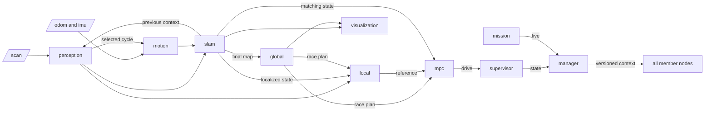

# Modular stack organization

The standard driver-card entry point is `launch/drive.launch.py`.
`launch/modular.launch.py` is an alias for the same graph. Both launch exactly
eight member nodes and the existing `feb_mission` node. There is no monolithic
driver, compatibility import layer or implementation selector.

```text
stack/
├── feb_mission/                 Existing mission lifecycle package
├── feb_wall_racer_msgs/         Typed ROS interfaces; built before the runtime
│   ├── msg/                    Run, cycle, motion, map, plan and health messages
│   ├── CMakeLists.txt
│   └── package.xml
└── feb_wall_racer/
    ├── feb_wall_racer/
    │   ├── nodes/              ROS subscriptions, publications and lifecycle
    │   ├── core/               Reusable estimation/planning/control algorithms
    │   ├── benchmarks/         Offline tests of those same algorithms
    │   ├── configuration.py    Configuration loading, ownership and identities
    │   ├── params.py           Complete wall-stack defaults
    │   ├── control_params.py   Shared racing/control defaults
    │   ├── interfaces.py       Typed transport conversion and validation
    │   ├── topics.py           Internal topic registry
    │   ├── qos.py              Shared QoS policies
    │   └── launching.py        Single modular launch implementation
    ├── config/                Driver tuning, car overlay and node deadlines
    ├── launch/                Standard entry point and modular alias
    ├── test/                  Node, transport, lifecycle and numerical regressions
    ├── tools/                 Diagnostic capture, comparison and replay scripts
    ├── docs/                  Contracts, organization and historical evidence
    ├── driver.yaml            Driver card, modes and adapter contract
    ├── setup.py               Eight node executables plus two offline benches
    └── package.xml            Runtime dependencies
```

Other existing workspace packages are unchanged and are not launched by this
driver. Benchmark-specific cone geometry is confined to `benchmarks/cone_track.py`;
it does not supply the wall raceline or add a runtime node. The `wall_bench` and
`mpc_bench` executable names remain available.

## Node ownership and connections

- `perception_node`: `/scan` to fitted walls and selected scan-cycle metadata.
  It uses bounded previous-map evidence without waiting on same-cycle SLAM.
- `motion_estimator_node`: held `/odom`, `/imu` and selected cycles to motion
  snapshots. Published `/drive` requests supply model inputs; supervisor feedback
  is diagnostic.
- `slam_node`: matching walls and motion to pose, wall context and finalized map.
  It alone broadcasts estimated `map -> feb_wall_racer_base` TF.
- `global_planner_node`: finalized map to validated cyclic raceline and speed plan.
- `local_planner_node`: walls, localized state and global plan to the current
  mapping/degraded/racing reference.
- `mpc_controller_node`: matching reference and state to `/drive`. It alone owns
  that publisher and independently checks direct stop, expiry and fault conditions.
- `run_manager_node`: supervisor state, mission-live and explicit node health to
  run context, reset/plan barriers and public status.
- `visualization_node`: state, walls and plans to display paths, pose and markers.
  It has no command or TF authority and is noncritical to driving.



The stock supervisor retains output arbitration and timeouts. No separate command
gate is introduced. Driver/car/explicit parameter layers are normalized once and
distributed to their declared consumers with one configuration identity; see
[parameter ownership](node-parameter-ownership.md).

Historical design and validation documents refer to the extraction baseline.
They are not alternate runtime implementations or current launch instructions.
